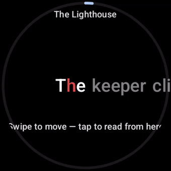
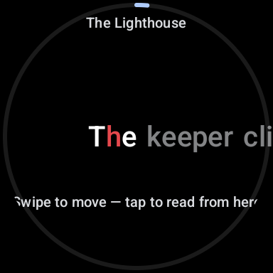
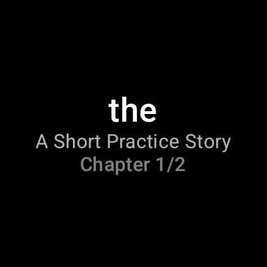

# RSVP Reader for Pixel Watch

Read books and articles on your wrist, one word at a time.

RSVP Reader is a Wear OS speed reader using Rapid Serial Visual Presentation:
words are flashed at a fixed point at a speed you control, with the optimal
recognition point (ORP) letter highlighted so your eyes never move. A phone
companion app sends EPUB books, shared articles, or pasted text to the watch.

Inspired by [rsvpnano](https://github.com/ionutdecebal/rsvpnano) (an ESP32
reading device); reimplemented from scratch in Kotlin for Wear OS.

## Demo



| Paused — context fades in around the pinned word | Continue-reading tile |
|---|---|
|  |  |

## Modules

- `:core` — pure Kotlin: RSVP engine (tokenization, per-word timing, ORP),
  book model, JSON serialization, file storage. Fully unit tested.
- `:wear` — the watch app: Compose for Wear OS. Library → chapters → reader,
  with four reading modes, an in-reader menu, a seek sheet, and a
  continue-reading tile that deep-links back into the reader. Reading
  position and settings persist via DataStore.
- `:mobile` — the phone companion: import EPUBs (file picker or share sheet),
  share/paste text, manage the sent library, set default speed/font. Syncs
  to the watch over the Wearable Data Layer (books as Assets at
  `/books/<id>`, settings at `/settings`).

## Building

Requires JDK 17+ and the Android SDK (platform 35).

```sh
./gradlew assembleDebug        # both APKs
./gradlew test                 # all unit tests
./gradlew :wear:installDebug   # install on a connected watch/emulator
./gradlew :mobile:installDebug # install on a connected phone
```

Both apps share the `com.jonahzander.rsvpreader` application id and must be
signed with the same key for the Data Layer to route between them.

Debug builds scroll poorly on real watches (no R8/AOT — a known Wear OS
Compose limitation). For actual use install the release build:

    ./gradlew :wear:assembleRelease :mobile:assembleRelease
    adb -s <watch> install -r wear/build/outputs/apk/release/wear-release.apk
    adb -s <phone> install -r mobile/build/outputs/apk/release/mobile-release.apk

## Reading modes (watch)

Pick a mode in the watch Settings:

- **RSVP** — words flash at a fixed point with the ORP letter highlighted.
  Words get extra display time when they are long or end a clause/sentence.
- **Line** — the same line of text crawls continuously under the fixed point.
- **Paged** — e-reader pages; tap the left/right edges or turn the crown.
- **Scroll** — an auto-scrolling column of text; tap to start/stop.

## Reading controls (watch)

| Input | Playing | Paused |
|---|---|---|
| Tap | pause (RSVP/Line) | play |
| Crown | change WPM (100–900) | scrub / page / scroll |
| Swipe down | open the menu (Chapters / Library / Settings / Exit) | same |
| Swipe up | open the seek sheet (jump within the chapter) | same |
| Swipe right | — | back |

Scroll mode has no seek sheet and opens the menu with a long press.
The screen stays on only while words are streaming. The continue-reading
tile shows the last word read and jumps straight back into the reader.
